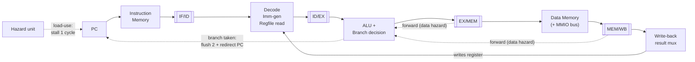

# RISC-V CPU — from scratch in Verilog

A working **32-bit RISC-V (RV32IM) processor**, written in Verilog and verified
in simulation — with memory-mapped I/O, machine-mode traps and interrupts, its
own assembler, a C toolchain path, and a synthesizable **FPGA system-on-chip**
that prints to a real serial terminal and to a TV over HDMI. It comes in two
flavors, built on the same datapath:

1. **`single_cycle/`** — one instruction per clock cycle. Simple; the place to
   start understanding how a CPU works. Also carries the **CSR / trap** unit
   (`ecall`, illegal-instruction, and a **timer interrupt**).
2. **`pipelined/`** — a classic **5-stage pipeline** (IF · ID · EX · MEM · WB)
   with **data forwarding**, **load-use stall detection**, and **branch
   flushing** — the three mechanisms that make a real pipeline correct.

Both run real machine-code programs and self-check their results — and a
**differential test proves the two cores compute byte-for-byte identical state**
on the same program. Everything is free and runs entirely in software; the same
Verilog also synthesizes onto a ~$15 FPGA (see `docs/FPGA.md`).

> Built as a self-directed project to understand what's actually *inside* a
> processor — going from "I know the fetch-decode-execute cycle" (concept) to
> "I built one that executes real instructions" (engineering).

---

## What it can do

Implements the RV32I base integer ISA plus the M extension:

| Category    | Instructions                                          |
|-------------|-------------------------------------------------------|
| Arithmetic  | `add sub and or xor slt sltu sll srl sra`             |
| Immediate   | `addi andi ori xori slti sltiu slli srli srai`        |
| **Multiply/Divide (M)** | `mul mulh mulhsu mulhu div divu rem remu` — incl. the spec's divide-by-zero and INT_MIN/−1 edge cases |
| Memory      | `lb lh lw lbu lhu · sb sh sw` (all sizes, sign/zero-extension) |
| Branches    | `beq bne blt bge bltu bgeu`                            |
| Jumps       | `jal jalr`                                              |
| Upper imm   | `lui auipc`                                             |
| **System (Zicsr)** | `csrrw csrrs csrrc` (+ `i` forms) · `ecall ebreak mret` — machine-mode CSRs, traps, and a timer interrupt |

Plus a **memory-mapped I/O bus** (decoded in `dmem.v`, just like a real SoC):

| Address      | Device | What it does                                   |
|--------------|--------|------------------------------------------------|
| `0x10000000` | UART   | store a byte → it prints on the console / real serial |
| `0x10000004` | TIMER  | load → cycles since reset (programs time themselves) |
| `0x10000008` | HALT   | store → simulation stops (value = exit code)   |
| `0x1000000C` | LCD    | store a byte → text on a TV over HDMI (on real hardware) |
| `0x10000010` | CLKHZ  | load → the CPU clock in Hz (so a program can time itself on any build) |

That combination is what turns a datapath demo into an *application target*:
programs written in assembly print text, convert numbers to decimal with
`divu`/`remu`, and report their own cycle counts.

---

## Quick start

```bash
# one-time toolchain install (free):
brew install icarus-verilog          # the simulator
brew install --cask gtkwave          # optional: waveform viewer

# from this folder:
make single      # build + run the single-cycle core   -> should print ALL TESTS PASSED
make pipeline    # build + run the 5-stage pipeline     -> should print ALL TESTS PASSED
make hazard      # forwarding + load-use stall test     -> should print ALL HAZARD TESTS PASSED
make mext        # M extension (mul/div) test, BOTH cores
make memops      # byte/half load-store test, BOTH cores
make traps       # Zicsr: ecall + illegal-instr + timer interrupt
make diff        # PROVE single-cycle & pipeline reach identical state
make hello       # run programs/hello.s  -> "HELLO FROM MY RISC-V CPU!"
make fib         # run programs/fib.s    -> "fib(15) = 610" + its cycle count
make apps        # hello + fib on both cores

# verified building blocks (see docs/ROADMAP.md) and the FPGA system:
make muldiv      # multi-cycle mul/div vs the ALU (2000+ random cases)
make bpred       # 2-bit branch predictor (BHT + BTB)
make rvc         # compressed-instruction decompressor vs assembler goldens
make fpga-tests  # UART, LCDs, FIFO, and the full SoC end-to-end (CPU -> real UART)
make synth       # synthesize the SoC for a Tang Nano 9K (needs Yosys/apicula)
make load PROGRAM=fib   # send a program to the running board over USB, no rebuild
make cprog-run   # compile sw/hello.c with riscv-gcc and run it on the core

make all         # every test above (this is what CI runs)
make clean       # remove build artifacts
```

### Write your own programs

`tools/asm.py` is a small two-pass RV32IM assembler (labels, `.data`,
pseudo-instructions like `li/la/call/ret`). Write assembly, assemble, run:

```bash
python3 tools/asm.py programs/hello.s     # -> hello.hex (+ hello.data.hex)
make hello                                # run it on the CPU
```

```asm
        li   t0, UART          # the console device
        la   t1, msg           # your string in .data
loop:   lbu  t2, 0(t1)
        beqz t2, done
        sb   t2, 0(t0)         # print one character
        addi t1, t1, 1
        j    loop
```

Every run prints PASS/FAIL for each checked value. The programs are
self-checking, so "ALL TESTS PASSED" means the CPU actually executed the
program correctly.

### Looking at waveforms (optional)
```bash
make pipeline          # generates sim/pipeline.vcd
make waves-pipeline    # opens it in GTKWave
```
Waveforms let you *see* every signal cycle by cycle — the PC advancing,
instructions moving through the 5 stages, forwarding kicking in.

---

## How the two cores compare

| | Single-cycle | 5-stage pipeline |
|---|---|---|
| Instructions in flight | 1 | up to 5 |
| Cycles per instruction | 1 | ~1 (plus stalls/flushes) |
| Clock speed (real HW) | slow (one long path) | fast (short stages) |
| Measured on the Tang Nano 9K | 12.6 MHz (fails at 27) | 21 MHz (fails at 31.5) |
| Complexity | low | needs hazard handling |
| Where to start reading | **here** | after the single-cycle core |

Same instruction set, same results — the pipeline is just the single-cycle
datapath sliced into 5 stages to run faster. Proving both give **identical**
answers on the same program is the whole point: it shows the pipeline's extra
machinery is correct.

---

## Microarchitecture: how the 5-stage pipeline works

A pipeline is an **assembly line for instructions**. Instead of finishing one
instruction completely before starting the next, the CPU works on **five
instructions at once**, each at a different point in its life. While
instruction A is being written back, instruction B is reading memory, C is in
the ALU, D is being decoded, and E is being fetched — all in the same clock
cycle.

The boxes labelled `IF/ID`, `ID/EX`, `EX/MEM`, `MEM/WB` are **pipeline
registers**: small banks of flip-flops that hold one instruction's data and
control signals and hand them one stage forward on every clock edge. They're
the "conveyor belt segments" between the workstations.



<div align="center"><sub><b>①&nbsp;IF</b> fetch&nbsp;·&nbsp;<b>②&nbsp;ID</b> decode&nbsp;·&nbsp;<b>③&nbsp;EX</b> execute&nbsp;·&nbsp;<b>④&nbsp;MEM</b> memory&nbsp;·&nbsp;<b>⑤&nbsp;WB</b> write-back — dashed arrows are the three hazard mechanisms below</sub></div>

Overlapping instructions is what makes the pipeline fast, but it creates
**hazards** — situations where an instruction needs something that isn't ready
yet. Getting these three right *is* the hard part of the project, so here's
exactly how each is solved in the RTL.

### 1. Data forwarding — the `EX/MEM` and `MEM/WB` bypass (`forwarding_unit.v`)

```asm
add x1, x2, x3     # computes x1 ...
sub x4, x1, x5     # ... but needs x1 the very next cycle
```

When `sub` reaches the ALU, `add` hasn't written `x1` back to the register file
yet — so simply reading the register would fetch the **stale** value. The fix:
the result `add` computed is *already sitting in a pipeline register*, so we
**forward** (bypass) it straight into the ALU's input, skipping the register
file entirely. No stall needed.

The forwarding unit compares the destination register of the two instructions
ahead against the registers the ALU instruction is reading, and picks the
**freshest** source:

| Situation | Forward select | Meaning |
|---|---|---|
| Producer is 1 instruction ahead (in `EX/MEM`) | `2'b10` | most recent — **wins** |
| Producer is 2 instructions ahead (in `MEM/WB`) | `2'b01` | next best |
| No match | `2'b00` | no hazard — read the register file |

`EX/MEM` is checked **first** on purpose: if the same register was written by
two recent instructions, the more recent one must win. (`x0` is excluded — it's
hard-wired to zero, so it's never a real dependency.)

### 2. Load-use stall — the one hazard forwarding *can't* fix (`hazard_unit.v`)

```asm
lw  x1, 0(x2)      # x1 isn't known until the END of the MEM stage
add x4, x1, x5     # but needs x1 at the START of its EX stage
```

A load's value doesn't exist until memory has been read — one cycle *too late*
to forward. No wire can send data back in time, so the only option is to
**stall**: freeze the younger instruction for exactly one cycle. The hazard
unit detects it with a single condition — *the instruction in EX is a load, and
the instruction right behind it reads that load's destination register* — and
asserts `stall`, which the top level uses to:

- **freeze the PC** (don't fetch anything new),
- **freeze the `IF/ID` register** (hold the stalled instruction in place), and
- **inject a bubble** into `ID/EX` (a `nop` with all control signals off).

One cycle later the loaded value has reached `MEM/WB`, ordinary forwarding takes
over, and the pipeline continues. Cost: a single wasted cycle, only when it's
genuinely unavoidable.

### 3. Control hazards — branches resolved in EX, then flush (`riscv_pipeline.v`)

The CPU doesn't know whether a branch is taken until the ALU compares the two
values in the **EX** stage. By then, the two instructions *behind* the branch
have already been fetched and decoded on the assumption the branch falls through
(this is **predict-not-taken**). If the branch *is* taken, those two are on the
wrong path, so the pipeline **flushes** them — turns both into bubbles — and
redirects the PC to the branch target. `jal`/`jalr` jumps redirect the same way.

Cost: two wasted cycles per *taken* branch; not-taken branches cost nothing.
This is why the little demo programs show *more* cycles on the pipeline than on
the single-cycle core — but each pipeline cycle is a much shorter, faster path
in real hardware, which is the whole point of pipelining.

> **In short:** forwarding handles *most* data dependencies for free; the hazard
> unit stalls one cycle for the load-use case forwarding can't reach; and taken
> branches flush the two wrong-path instructions. Those three mechanisms are
> what make an overlapping pipeline produce the *same answers* as the simple
> single-cycle core — which `make diff` proves byte-for-byte.

---

## Repository layout

```
riscv-cpu/
├── README.md                 <- you are here
├── Makefile                  <- build + run everything
├── docs/
│   ├── ARCHITECTURE.md        <- datapath + pipeline diagrams, how each stage works
│   ├── LEARNING.md            <- guided reading order + a real bug I hit & fixed
│   ├── VERIFICATION.md        <- how the CPU is tested (differential + randomized)
│   ├── FPGA.md                <- synthesize & run on a Tang Nano 9K
│   └── ROADMAP.md             <- what's built + how to integrate the common/ blocks
├── single_cycle/
│   ├── defines.vh             <- opcodes / ALU codes (read this first)
│   ├── alu.v                  <- the "calculator"
│   ├── regfile.v              <- the 32 registers
│   ├── imm_gen.v              <- pulls constants out of instructions
│   ├── control.v              <- decodes instructions into control signals
│   ├── imem.v / dmem.v        <- instruction & data memory (+ MMIO bus)
│   ├── csr.v                  <- CSRs + machine-mode traps + timer interrupt
│   ├── riscv_single.v         <- TOP: wires it all into a CPU
│   └── tb_single.v            <- testbench
├── pipelined/
│   ├── regfile_pipe.v         <- register file (write-first, for the pipeline)
│   ├── forwarding_unit.v      <- solves data hazards without stalling
│   ├── hazard_unit.v          <- detects the load-use hazard -> stall
│   ├── riscv_pipeline.v       <- TOP: the 5-stage pipeline
│   ├── tb_pipeline.v          <- testbench (same program as single-cycle)
│   └── tb_hazard.v            <- testbench that stresses forwarding + stalls
├── common/                    <- verified, ready-to-integrate building blocks
│   ├── muldiv_seq.v           <- multi-cycle (bit-serial) multiply / divide
│   ├── branch_predictor.v     <- 2-bit saturating BHT + BTB
│   └── rvc_decompress.v       <- expand 16-bit RVC instructions to 32-bit
├── fpga/                      <- the synthesizable system-on-chip (Tang Nano 9K)
│   ├── soc_tangnano9k.v       <- TOP: core + peripherals + LEDs
│   ├── uart_tx.v / uart_rx.v  <- real 8N1 serial (to your PC over USB)
│   ├── hdmi_term.v            <- HDMI text terminal (640x480, TMDS encoders)
│   ├── uart_loader.v          <- loads new programs over the UART (see tools/load.py)
│   ├── font8x16.hex           <- its font (generated by tools/genfont.py)
│   ├── st7789_term.v          <- 1.14" SPI screen terminal (alternative)
│   ├── font6x12.hex           <- its font
│   ├── lcd_hd44780.v          <- 16x2 character LCD driver (alternative, not in the SoC)
│   ├── fifo.v / por.v         <- byte FIFO + power-on reset
│   └── tangnano9k.cst         <- physical pin map
├── sw/                        <- run C on the core (crt0 + linker script + hello.c)
├── tools/
│   ├── asm.py                 <- two-pass RV32IM+Zicsr assembler (labels, .data, pseudo-ops)
│   └── bin2hex.py             <- ELF-section binary -> $readmemh image (for the C flow)
├── tests/
│   ├── tb_mext.v              <- M-extension checks (runs on BOTH cores via -DUSE_PIPE)
│   ├── tb_memops.v            <- byte/half load-store checks (both cores)
│   ├── tb_run.v               <- generic app runner: UART -> console, stops on HALT
│   ├── tb_diff.v              <- single-cycle vs pipeline equivalence check
│   ├── tb_muldiv.v            <- sequential mul/div vs the ALU (randomized)
│   ├── tb_bpred.v tb_rvc.v    <- branch-predictor + RVC decompressor checks
│   └── tb_uart.v tb_lcd.v tb_st7789.v tb_hdmi.v tb_fifo.v tb_soc.v  <- FPGA peripherals + SoC end-to-end
├── programs/
│   ├── sum.hex                <- computes 1+2+...+10 = 55
│   ├── hazards.hex            <- every instruction depends on the previous one
│   ├── hello.s                <- prints "HELLO FROM MY RISC-V CPU!" via the UART
│   ├── fib.s                  <- fib(15) printed in decimal + its own cycle count
│   ├── mext_test.s            <- mul/div self-test (all the nasty edge cases)
│   ├── memops_test.s          <- byte/half access self-test
│   ├── traps.s                <- ecall + illegal-instruction + timer interrupt
│   └── difftest.s             <- deterministic workout for the equivalence check
└── sim/                       <- generated .vvp (compiled) and .vcd (waveform) files
```

**Suggested reading order:** `docs/LEARNING.md` → `single_cycle/defines.vh` →
the small modules → `single_cycle/riscv_single.v` → then the pipeline.

---

## Next step (optional): run it on real hardware

Everything here is simulation, which is complete and legitimate. If you ever
want to see it run on a physical chip:

- Write the core onto a cheap FPGA — a **Tang Nano 9K (~$15–20)** is plenty and
  the open-source toolchain (Yosys + nextpnr / apicula) is free.
- The Verilog is already synthesizable; you'd add a top-level that maps the PC
  or a register to on-board LEDs so you can watch a program run.

Not required — the simulated, waveform-verified core stands on its own.

---

## Status

- [x] Single-cycle RV32I core — **all tests pass**
- [x] 5-stage pipeline with forwarding, stalls, branch flush — **all tests pass**
- [x] Hazard stress test — **all tests pass**
- [x] Byte/halfword loads & stores (`lb lh lbu lhu sb sh`) — **tested on both cores**
- [x] **M extension** (`mul/div` × 8, incl. div-by-0 and INT_MIN/−1 edge cases) — **tested on both cores**
- [x] **Zicsr + machine-mode traps**: `ecall`, `ebreak`, illegal-instruction, `mret`, CSRs, and a **timer interrupt** — **self-checked** (`make traps`)
- [x] **Differential equivalence**: single-cycle vs pipeline reach identical register + memory state — **proven** (`make diff`)
- [x] **Memory-mapped I/O**: UART console + cycle timer + halt + LCD device
- [x] **Assembler** (`tools/asm.py`, RV32IM + Zicsr + pseudo-instructions + `.data`)
- [x] **Applications**: `hello.s`, `fib.s`, `traps.s` run and print on the cores
- [x] **FPGA SoC** (`fpga/`): synthesizable core + real UART transmitter + HDMI text terminal + FIFOs + power-on reset, with a full **end-to-end SoC test** (CPU → real `uart_tx` → decoded back) — **simulated & self-checked**
- [x] **C toolchain path** (`sw/`): compile C with riscv-gcc and run it on the core
- [x] **Continuous integration**: GitHub Actions runs the whole suite on every push
- [x] **Verified, ready-to-integrate blocks** (`common/`): sequential mul/div, 2-bit branch predictor, RVC decompressor — each self-checked (`make muldiv bpred rvc`)
- [ ] (stretch) synthesize onto an FPGA (Tang Nano 9K + open toolchain) — RTL + flow ready, see `docs/FPGA.md`
- [ ] (stretch) official `riscv-arch-test` compliance + `riscv-formal` — see `docs/VERIFICATION.md`

> A note on the app cycle counts: the pipeline shows *more cycles* than the
> single-cycle core on these branchy little programs (every taken branch
> flushes 2 instructions). That's expected — the pipeline's win is a much
> faster CLOCK in real hardware (each stage is a short path), not fewer
> cycles. Seeing that trade-off in your own numbers is the point.
```
